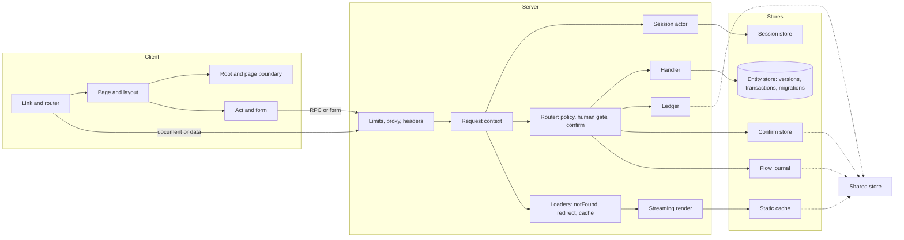

# Design

Status: design for work not yet done. Nothing here is evidence that a behaviour exists.

## Boundary

| Area | This feature changes | This feature leaves alone |
|---|---|---|
| Package and release | Exports, peers, engines, maps, version constant, workflows, post-publish check | The act of publishing, which is an Ask |
| Server | Limits, proxy trust, headers, context, sessions, loader control, caching, streaming, observability, shared stores | The choice of Hono and oRPC |
| Client | Error boundaries, data scoping, hydration codec, routing grammar, layouts, links, page states, forms, head | The nine-state page contract and React 19 |
| Data | Store versions and transactions, migrations, PostgreSQL, cursors, policy context | The entity declaration shape |
| Build | User Vite section, production pipeline, adapters, entry weight, externals, images | Vite as the bundler |
| Checker and CLI | Suppression, severity, baseline, isolation, incremental runs, outputs, new commands | The rule catalog identifiers |
| Agent contract | Unique addresses, schema version, discovery, conformance suite | The sidecar as the mechanism |
| Docs and project | API surface, tutorial, guides, changelog, examples, contribution path | The spec folder and the house commit format |

## Invariants

1. The server decides. No authorization, confirmation or audit outcome depends on what a client chose to send or skip.
2. An action runs only after a deliberate act by a person or an attributed agent. Loading a URL is not such an act.
3. Server code never reaches the browser. When that cannot be proven for a handler, the build fails.
4. Every server state that matters after a restart sits behind an interface with a bounded default and a durable or shared implementation.
5. A committed action stays committed. A failure in bookkeeping after commit is reported and never rewrites the response.
6. One declaration feeds every surface. A capability added here extends that declaration or the configuration schema.
7. One matcher decides routes for the server, the static cache and the client.
8. A response reveals nothing internal: no raw error text, no unlisted actor attribute, no development route in a production build.
9. A check is never weakened to pass. Tests assert behaviour, and a disagreement is recorded.
10. A status in this pack is a record, not a promise. A case is UNRUN until a command ran and its output was kept.

## Architecture after this feature

## One task from claim to main

1. The wave manager cuts `wave/rex-v04/N` from `main` once every wave named in `after` has landed.
2. The manager reads the eligible tasks: all `requires` done, every consumed interface provided.
3. For each eligible task the manager starts a worker with `hyperfide fleet begin W.N --agent w-rex-v04-W.N`. This creates the task branch and worktree and takes the claim.
4. The worker reads its task, the clauses it cites, the interfaces it provides and consumes, and the audit items it names. It writes the whole implementation and its tests before running anything.
5. The worker qualifies: format touched files, one typecheck, one `verify_cmd`. Two repair cycles at most. It commits in the house format and reports revision, command, exit code and log path.
6. The manager reviews the diff against the task's clauses and `touches`, then merges the task branch into the wave branch with `hyperfide fleet merge-up W.N` and marks the task done through `hyperfide spec done`.
7. When every task in the wave is merged, the manager regenerates the derived documentation, runs both gate scripts on the wave head and records the wave gate case.
8. The main integrator reviews the wave report, lands the wave with `hyperfide fleet land N`, and starts the next wave.

A worker that needs a path outside its `touches` widens with `hyperfide slice W.N --widen PATH --reason CODE`. A worker that finds an unrelated failure appends one entry to [qualification.kvx](qualification.kvx) and moves on. A worker that needs a human decision reports it; the manager records it in [asks.kvx](asks.kvx) and proceeds on a stated assumption unless the Ask blocks.
